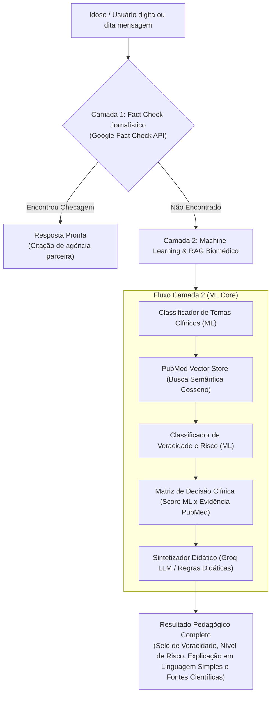

# MedFact — Detector de Desinformação em Saúde para Idosos

<p align="center">
  
  
  
  
  
  
  
  
  
  
</p>

> **Projeto Acadêmico — Sistemas de Machine Learning (2026/02)**  
> **Universidade de Brasília (UnB) — Engenharia de Software**  
> **Equipe: Os Sem Classe**  
> **Participante:** Sauhan Ferreira Melo (242024923) — GitHub: [`@SUDOTMOX`](https://github.com/SUDOTMOX)

---

## Acessos Rápidos em Produção

- **Aplicação Web em Produção (AWS Amplify):**  
  [https://main.d1ld9fjorca4sg.amplifyapp.com/](https://main.d1ld9fjorca4sg.amplifyapp.com/)
- **Documentação Técnica Oficial (GitHub Pages):**  
  [https://unb-sistemas-de-machine-learning.github.io/challenge_1_os_sem_classe/](https://unb-sistemas-de-machine-learning.github.io/challenge_1_os_sem_classe/)
- **Swagger / OpenAPI (Local):**  
  `http://localhost:3001/docs`

---

## Sobre o MedFact

O **MedFact** é uma plataforma inteligente concebida para combater os impactos críticos da desinformação em saúde no público idoso. Recebendo alegações sobre **vacinação, COVID-19, diabetes, hipertensão e doenças crônicas**, o sistema:

1. Cruza a alegação com checagens jornalísticas existentes (Google Fact Check Tools API).
2. Na ausência de checagens consolidadas, aciona o núcleo proprietário de **Machine Learning e RAG**, consultando uma base vetorial local construída a partir do **PubMed / NCBI**.
3. Classifica a probabilidade de veracidade e calcula o potencial risco de dano clínico ao paciente.
4. Gera uma síntese didática, empática e acolhedora orientada a pessoas idosas através de LLM (Groq Llama 3 70B) ou motor heurístico de contingência local, enfatizando a continuidade de tratamentos e a consulta com profissionais de saúde.

---

## Arquitetura em Duas Camadas



---

## Recursos de Acessibilidade e Inclusão

Projetado sob as diretrizes **WCAG 2.1 nível AA**, com foco nas necessidades motoras, cognitivas e visuais de pessoas idosas:

- **Mascote Interativo (MascotPill):** Guia visual em formato de pílula acolhedora com expressões reativas aos estados do sistema (`idle`, `typing`, `loading`, `result`, `erro`).
- **Escalonamento Dinâmico de Tipografia:** Três níveis reais de escala de fonte (Padrão, Grande e Muito Grande) via variáveis CSS globais.
- **Modo Alto Contraste:** Tema com proporção de contraste estrita superior a 7:1, com bordas reforçadas para baixa visão.
- **Síntese de Voz (Leitura em Áudio):** Leitura falada automática de laudos através da Web Speech API nativa dos navegadores.
- **Ditado por Voz:** Reconhecimento de fala via microfone integrado diretamente no campo de busca.
- **Navegação por Teclado e Foco Visível:** Atalho `Ctrl + Enter` para envio rápido e indicadores de foco em conformidade de acessibilidade.
- **Salvaguarda Médica:** Aviso clínico permanente esclarecendo que o sistema é informativo e não substitui o médico.

---

## Engenharia de Qualidade e Testes de Software

O projeto conta com **70 testes automatizados** com **100% de taxa de sucesso**, cobrindo o frontend e o backend com testes de **caixa branca** e **caixa preta**:

### Cobertura de Código no Backend (~90% médio)

| Módulo | Tipo de Teste | Cobertura |
|---|---|---|
| `app/services/fact_check.py` | Caixa Branca / Caixa Preta | **100%** |
| `app/services/database.py` | Caixa Branca (Isolamento SQLite) | **98%** |
| `app/services/synthesizer.py` | Caixa Branca (Branches e Fallbacks) | **98%** |
| `app/services/vector_store.py` | Caixa Branca (Similaridade Cosseno) | **94%** |
| `app/services/pubmed_service.py` | Caixa Branca (Tradução MeSH) | **87%** |
| `app/services/ml_engine.py` | Caixa Branca (Inference Pipeline) | **82%** |

### Tipos de Testes Implementados

1. **Testes de Caixa Branca (`test_whitebox.py`):**
   - **Branch Coverage:** Mapeamento de todos os caminhos condicionais do `FactCheckService`.
   - **Tradutor MeSH de Termos Médicos:** Normalização fonética/ortográfica e fallback com termos não mapeados.
   - **Matriz de Decisão Clínica:** Cobertura de 4 cenários cruzados de pontuação probabilística vs. evidências científicas.
   - **Injeção de Falhas de LLM:** Simulação de erro 429/timeout na API Groq, garantindo ativação imperceptível do sintetizador heurístico local.
   - **Vector Store Semântico:** Busca vetorial com filtros restritos por tópico clínico.

2. **Testes de Caixa Preta (`test_blackbox.py`):**
   - **Análise de Valor Limite (BVA):** Validação estrita de limites de entrada (strings de 0 a 4 caracteres rejeitadas com HTTP 422; 5 caracteres e entradas longas aceitas).
   - **Particionamento de Equivalência (EP):** Classes de equivalência cobrindo domínios clínicos (`diabetes`, `hipertensao`, `vacinas`).
   - **Contratos de Schema REST:** Validação de schemas Pydantic nos endpoints `/verify`, `/health`, `/telemetry/metrics` e `/feedback`.
   - **Efeito de Cache Semântico:** Verificação de integridade e redução de latência em requisições repetidas.

3. **Testes de Frontend (`Jest` + `React Testing Library` — 23 testes):**
   - Estados, animações e cliques no `MascotPill`.
   - Alternância de contraste, escalonamento de fontes e síntese de áudio na `AccessibilityBar`.
   - Comportamento de abertura/fechamento do `AboutModal`.
   - Renderização SVG e atributos ARIA do `LogoIcon`.
   - Fluxo completo da experiência do usuário em `App.test.js`.

---

## Ciclos de MLOps & DevOps

### MLOps
- **Pipelines de Treinamento Automatizado:** Scripts em `mlops/scripts/train_pipeline.py` para geração dos classificadores supervisionados.
- **Detecção de Data Drift:** Script `mlops/scripts/monitor_drift.py` que audita distribuições de palavras e desvios de vocabulário, gerando relatórios em `mlops/reports/drift_analysis.json`.
- **Telemetria de Produção:** Registro de consultas, latência, confiança probabilística e feedbacks de utilidade em banco SQLite WAL.

### DevOps & CI/CD
- **GitHub Actions Pipeline (`ci.yml`):**
  - Execução dos 47 testes de backend com threshold de cobertura via `pytest-cov`.
  - Execução dos 23 testes de frontend com `npm test -- --watchAll=false`.
  - Validação estrita da documentação com `mkdocs build --strict`.
- **Contêineres e Orquestração:**
  - `compose.yaml` e `docker-compose.yml` com healthcheck ativo no endpoint `/health` (intervalo de 15s, timeout de 5s, 3 tentativas).
  - Deploy contínuo automatizado do frontend na AWS Amplify.

---

## Como Executar o Projeto

### Pré-requisitos
- Python 3.11+
- Node.js 18+ e npm
- Docker e Docker Compose (opcional para execução em contêineres)

### Opção 1: Via Docker Compose (Recomendado)

Inicie todos os microsserviços integrados com saúde monitorada:

```bash
docker compose up -d --build
```

- **Frontend:** `http://localhost:3000`
- **Backend API & Swagger:** `http://localhost:3001/docs`
- **MLflow Tracking:** `http://localhost:5001`

Para encerrar:
```bash
docker compose down
```

---

### Opção 2: Execução Local Direta

#### 1. Backend de Machine Learning (FastAPI)

```bash
# Instale as dependências
py -m pip install -r medfact/server_ml/requirements.txt

# Inicialize o banco de dados e semeie artigos do PubMed
py mlops/scripts/seed_pubmed.py

# Treine os modelos de Machine Learning (gera os classificadores .joblib)
py mlops/scripts/train_pipeline.py

# Inicie a API FastAPI
py -m uvicorn medfact.server_ml.app.main:app --host 0.0.0.0 --port 3001 --reload
```

#### 2. Frontend Web (React)

Em outro terminal:

```bash
cd medfact/client
npm install
npm start
```

A aplicação abrirá em `http://localhost:3000`.

---

## Como Executar os Testes

### Testes do Backend (Pytest com Cobertura):
```bash
py -m pytest medfact/server_ml/tests -v --cov=app --cov-report=term-missing
```

### Testes do Frontend (Jest / React Testing Library):
```bash
cd medfact/client
npm test -- --watchAll=false
```

---

## Documentação Técnica no MkDocs (GitHub Pages)

Para visualizar localmente o portal de documentação:

```bash
py -m mkdocs serve
# Disponível em: http://localhost:8000
```

Para validar a integridade de todos os links e sintaxe:

```bash
py -m mkdocs build --strict
```

### Páginas Documentadas:
1. [Visão Geral e Escopo](docs/index.md)
2. [Escopo e Requisitos Formais](docs/escopo.md)
3. [Arquitetura do Software](docs/arquitetura.md)
4. [Tecnologias Utilizadas](docs/tecnologias.md)
5. [Banco de Dados & PubMed](docs/banco-de-dados.md)
6. [Machine Learning & RAG Biomédico](docs/machine-learning.md)
7. [Relatório de Testes e Qualidade](docs/testes.md)
8. [Práticas de MLOps](docs/mlops.md)
9. [Práticas de DevOps & CI/CD](docs/devops.md)
10. [Acessibilidade & Usabilidade Sênior](docs/acessibilidade.md)
11. [Processos de Engenharia de Software](docs/processos-software.md)
12. [Guia de Instalação e Execução](docs/instalacao.md)

---

## Equipe e Autoria

- **Sauhan Ferreira Melo** — Matrícula: `242024923`  
  Universidade de Brasília (UnB) — Sistemas de Machine Learning  
  GitHub: [`@SUDOTMOX`](https://github.com/SUDOTMOX)

---

## Licença

Projeto acadêmico e de pesquisa desenvolvido no âmbito da **Universidade de Brasília (UnB)**.
