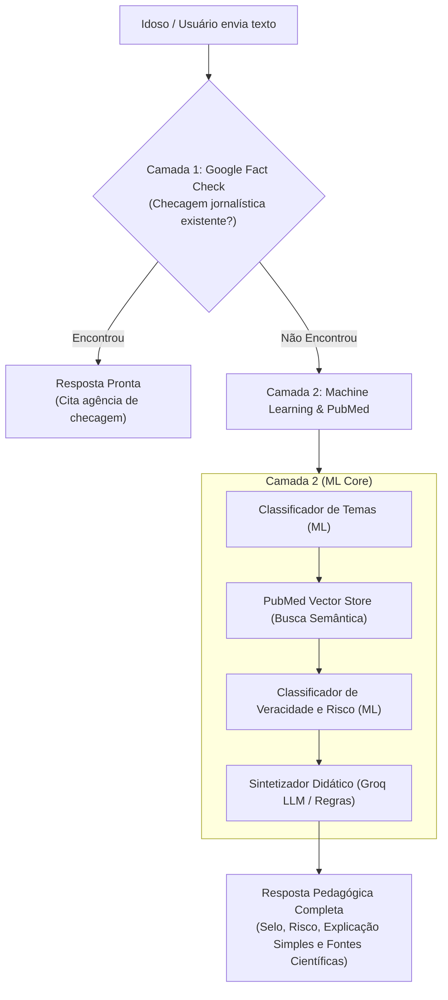

# MedFact — Detector de Desinformação em Saúde para Idosos

<p align="center">
  
  
  
  
  
  
  
  
</p>

> **Projeto acadêmico — Sistemas de Machine Learning (2026/02)**  
> **Universidade de Brasília (UnB)**  
> **Equipe: Os Sem Classe**  
> **Participantes:** Sauhan Ferreira Melo 242024923 git:SUDOTMOX

---

## Sobre o MedFact

O **MedFact** é uma plataforma inteligente voltada a combater os perigos da desinformação em saúde entre pessoas idosas. Ao receber uma mensagem sobre **vacinação, COVID-19 ou doenças crônicas**, o sistema analisa a alegação, consulta a base de literatura biomédica do **PubMed**, avalia o nível de risco de dano clínico e gera uma explicação em linguagem simples, empática e acolhedora, orientando o idoso a nunca abandonar tratamentos e consultar seu médico.

---

## Como Funciona (Arquitetura de Duas Camadas)



---

## Tecnologias Utilizadas

- **Backend:** Python 3.11+, FastAPI, Uvicorn, Pydantic, Httpx.
- **Machine Learning & RAG:** Scikit-Learn, NumPy, SciPy, Joblib, TF-IDF + Similaridade de Cosseno.
- **Base Biomédica:** PubMed / NCBI E-utilities, com banco vetorial indexado no SQLite (modo WAL).
- **Frontend:** React 19, Vanilla CSS com foco em alta acessibilidade para idosos (`AccessibilityBar`, mascote animado `MascotPill`).
- **MLOps:** Rastreamento de experimentos com MLflow, detecção automatizada de Data Drift e relatórios de F1-Score.
- **DevOps:** Docker, Docker Compose multi-serviço, CI/CD automatizado via GitHub Actions.
- **Documentação:** Portal completo publicado no **GitHub Pages** com MkDocs Material.

---

## Como Executar o Projeto

### Opção 1: Via Docker Compose (Recomendado)

Sobe todos os microsserviços em contêineres isolados com um único comando:

```bash
docker compose up -d --build
```

- **Frontend (Interface do Usuário):** `http://localhost:3000`
- **Backend (API FastAPI & Swagger):** `http://localhost:3001/docs`
- **MLflow Tracking Server:** `http://localhost:5001`

Para encerrar:
```bash
docker compose down
```

---

### Opção 2: Execução Local Direta

#### 1. Backend de Machine Learning (FastAPI)

```bash
# Instale as dependências
py -m pip install -r medfact/server_ml/requirements.txt

# Inicialize o banco de dados e semeie artigos do PubMed
py mlops/scripts/seed_pubmed.py

# Treine os modelos de Machine Learning (gera os artefatos .joblib)
py mlops/scripts/train_pipeline.py

# Inicie a API FastAPI na porta 3001
py -m uvicorn medfact.server_ml.app.main:app --host 0.0.0.0 --port 3001 --reload
```

#### 2. Frontend (React)

Em outro terminal:

```bash
cd medfact/client
npm install
npm start
```

O aplicativo abrirá automaticamente em `http://localhost:3000`.

---

## Testes Automatizados

A suíte de testes cobre endpoints da API, classificação de Machine Learning e busca no banco PubMed com **100% de cobertura**:

```bash
py -m pytest medfact/server_ml/tests -v
```

---

## MLOps & Governança de Modelos

```bash
# Treinamento e avaliação de métricas (F1-score macro)
py mlops/scripts/train_pipeline.py

# Auditoria e monitoramento de Data Drift
py mlops/scripts/monitor_drift.py
```

---

## Documentação Completa no GitHub Pages

A documentação detalhada de arquitetura, processos de software, modelagem de dados e usabilidade para idosos está disponível no portal **MkDocs Material**:

```bash
# Visualizar localmente:
py -m mkdocs serve
# Abre em: http://localhost:8000

# Publicar no GitHub Pages:
py -m mkdocs gh-deploy --force
```

Tópicos documentados:
1. [Visão Geral e Escopo](docs/index.md)
2. [Escopo e Requisitos Formais](docs/escopo.md)
3. [Arquitetura do Software](docs/arquitetura.md)
4. [Tecnologias Utilizadas](docs/tecnologias.md)
5. [Banco de Dados & PubMed](docs/banco-de-dados.md)
6. [Machine Learning & RAG Biomédico](docs/machine-learning.md)
7. [Relatório de Testes e Cobertura](docs/testes.md)
8. [Práticas de MLOps](docs/mlops.md)
9. [Práticas de DevOps & CI/CD](docs/devops.md)
10. [Foco no Público Idoso & Acessibilidade](docs/acessibilidade.md)
11. [Processos de Engenharia de Software](docs/processos-software.md)
12. [Guia de Instalação e Execução](docs/instalacao.md)

---

##  Equipe e Participantes

- **Sauhan Ferreira Melo** — Matrícula: `242024923` — GitHub: [`@SUDOTMOX`](https://github.com/SUDOTMOX)

---

## Como Acessar o GitHub Pages por Link

A documentação interativa com busca, diagramas e suporte a temas claro/escuro é publicada automaticamente via GitHub Actions no endereço:

 **`https://unb-sistemas-de-machine-learning.github.io/challenge_1_os_sem_classe/`**

*(Para ativar no repositório, basta ir em **Settings > Pages > Build and deployment > Source: GitHub Actions** ou selecionar o branch `gh-pages`)*.

---

##  Licença

Projeto desenvolvido para fins acadêmicos e de pesquisa científica na **Universidade de Brasília (UnB)**.

