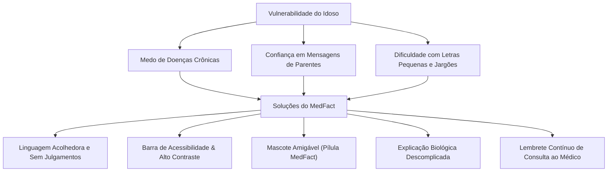

# Foco no Público Idoso & Acessibilidade

O MedFact não é um checador de fatos genérico. Ele foi desenhado desde a sua concepção para atender com sensibilidade, empatia e clareza as necessidades específicas de **idosos e seus cuidadores familiares**.

---

## 👵 O Idoso e a Desinformação em Saúde

Estudos em gerontologia e comunicação digital demonstram que idosos estão desproporcionalmente expostos e vulneráveis à desinformação por múltiplos fatores convergentes:

1. **Hiperconexão via Mensageria:** O WhatsApp é o principal canal de socialização e contato com familiares, onde boatos chegam embalados pelo afeto de parentes e amigos próximos (*"Recebi de uma prima médica..."*).
2. **Vulnerabilidade Clínica e Medo:** Idosos convivem com dores crônicas, diabetes, hipertensão ou medo de declínio cognitivo (Alzheimer), tornando promessas de curas fáceis e indolores irresistíveis.
3. **Barreiras de Letramento Digital:** Dificuldade em distinguir portais jornalísticos legítimos de sites apócrifos ou canais sensacionalistas de vídeos.
4. **Resistência a Rótulos Agressivos:** Dizer simplesmente que a pessoa *"compartilhou mentira"* gera vergonha, defensividade e rompimento do diálogo pedagógico.

---

## 🎨 Heurísticas de Design e Interface (Frontend)

O frontend React do MedFact foi refinado e mantido rigorosamente alinhado a critérios de acessibilidade física e cognitiva:

### 1. Tipografia Aumentada e Legibilidade
- Tamanho base de fonte ampliado (18px a 22px nos textos principais).
- Altura de linha generosa (`line-height: 1.6`) para prevenir fadiga visual.
- Contraste elevado entre texto escuro e fundo claro, cumprindo as diretrizes WCAG 2.1 AA.

### 2. Acolhimento Visual: Mascote Animado (`MascotPill`)
- A inclusão de um mascote simpático no formato de pílula animada reduz a frieza hospitalar e transforma o momento da consulta em uma interação descontraída e segura.
- O mascote reage visualmente, transmitindo a ideia de que o sistema está trabalhando para proteger a saúde da família.

### 3. Barra de Acessibilidade (`AccessibilityBar`)
- Controles de fácil acesso no topo da página que permitem:
    - Alternar entre contrastes visuais.
    - Alterar instantaneamente a escala tipográfica.
    - Acessar a janela de ajuda didática.

### 4. Selos Visuais Sem Ambiguidade
Em vez de códigos ou siglas enigmáticas, o resultado exibe selos grandes com cores consolidadas e mensagens autoexplicativas:

  VERDADEIRA
  FALSA
  ENGANOSA
  NÃO VERIFICÁVEL

---

## 🗣️ Síntese Textual Especializada (Prompt Engineering)

O gerador de explicações (`synthesizer.py`) opera sob um conjunto de diretrizes pedagógicas estritas para a terceira idade:

1. **Tom Empático e Respeitoso:**
   - ❌ *Evitar:* *"Essa alegação é absurda e não faz o menor sentido científico."*
   -  *Priorizar:* *"É natural termos dúvidas quando lemos mensagens alarmistas na internet. Porém, os médicos e cientistas já investigaram esse assunto..."*

2. **Explicação Biológica Descomplicada:**
   - Em vez de citar *"inibição de citocinas inflamatórias"*, explica que *"a vacina ensina o corpo a criar soldados de defesa para quando o vírus de verdade tentar entrar"*.

3. **Salvaguarda Clínica Obrigatória:**
   - Toda resposta sobre doenças crônicas ou medicamentos finaliza com um aviso claro:
     > *"Lembre-se: nunca pare de tomar seus remédios de pressão ou insulina por conta própria. Converse sempre com seu médico de confiança no posto de saúde antes de mudar qualquer tratamento."*
