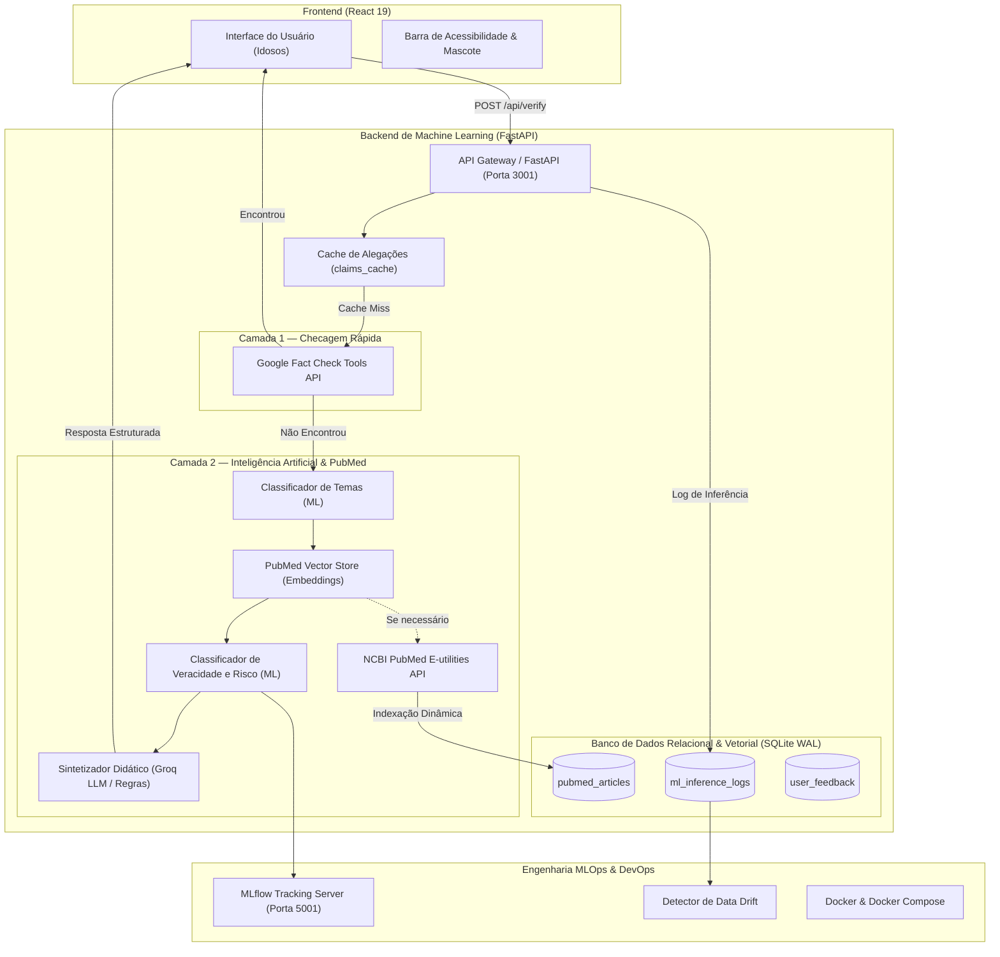
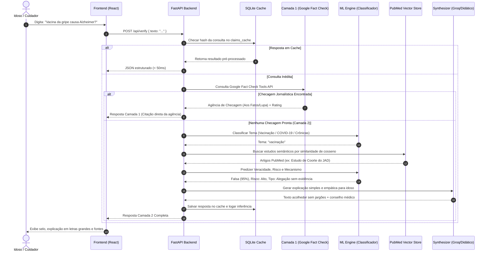

# Arquitetura do Software MedFact

A arquitetura do **MedFact** foi estruturada sob o paradigma de microsserviços desacoplados e orientada a dados, combinando engenharia de software tradicional, pipelines de Machine Learning e orquestração de evidências biomédicas.

---

## Visão Geral da Arquitetura

O sistema opera em uma estrutura de duas camadas complementares (**Two-Tier Verification**):

---

## Fluxo de Execução e Sequência

A interação entre o usuário idoso e os componentes internos segue o diagrama de sequência abaixo:

---

## Componentes do Sistema

### 1. Frontend (Interface do Usuário)
- **Tecnologia:** React 19 com CSS modular vanilla.
- **Responsabilidades:**
    - Coleta amigável da dúvida com botões de atalho para perguntas frequentes.
    - Barra de acessibilidade e mascote simpático ("Pílula MedFact") para engajar o usuário.
    - Exibição de selos claros com cores de alto contraste:
        - 🟢 **VERDADEIRA** (Verde esmeralda)
        - 🟡 **ENGANOSA** (Amarelo âmbar)
        - **FALSA** (Vermelho telha suave)
        -  **NÃO VERIFICÁVEL** (Cinza neutro)
    - Cartões com links clicáveis para os artigos originais do PubMed.

### 2. Backend Gateway & Orquestrador
- **Tecnologia:** Python 3.11+ com FastAPI e Uvicorn.
- **Responsabilidades:**
    - Validação de contratos Pydantic.
    - Orquestração assíncrona com `httpx`.
    - Sanitização e normalização semântica (remoção de acentos via NFD, pontuações e minúsculas).
    - Métricas Prometheus e telemetria de produção via endpoint `/api/metrics`.

### 3. Camada 1 — Google Fact Check
- **Responsabilidade:** Atalho oportunista de alta precisão para claims virais previamente investigadas por agências certificadas pelo IFCN (*International Fact-Checking Network*).
- **Vantagem de Produção:** Evita chamadas custosas ao modelo de linguagem quando jornalistas humanos já produziram a averiguação.

### 4. Camada 2 — Machine Learning & PubMed
- **Responsabilidade:** Quando a dúvida for inédita ou não constar nas agências, o MedFact aciona sua própria esteira de evidências científicas.
- **Subcomponentes:**
    - `ml_engine.py`: Classificadores supervisionados baseados em TF-IDF e regressão logística calibrada.
    - `vector_store.py`: Banco vetorial baseado em embeddings densos e cálculo de similaridade de cosseno em memória persistido no SQLite.
    - `pubmed_service.py`: Interface com a API oficial do NCBI E-utilities, com dicionário de tradução médica PT-BR -> MeSH Terms.
    - `synthesizer.py`: Motor de geração em linguagem simples, utilizando a API da Groq (Llama 3.1) com temperatura baixa (0.3) e fallback determinístico baseado em diretrizes médicas.

### 5. Camada de Persistência (Database)
- **Tecnologia:** SQLite configurado em modo WAL (*Write-Ahead Logging*).
- **Tabelas Principais:**
    - `pubmed_articles`: Artigos científicos indexados.
    - `claims_cache`: Cache de respostas com chave MD5.
    - `ml_inference_logs`: Auditoria de cada predição executada.
    - `user_feedback`: Avaliações de idosos sobre a clareza da explicação.