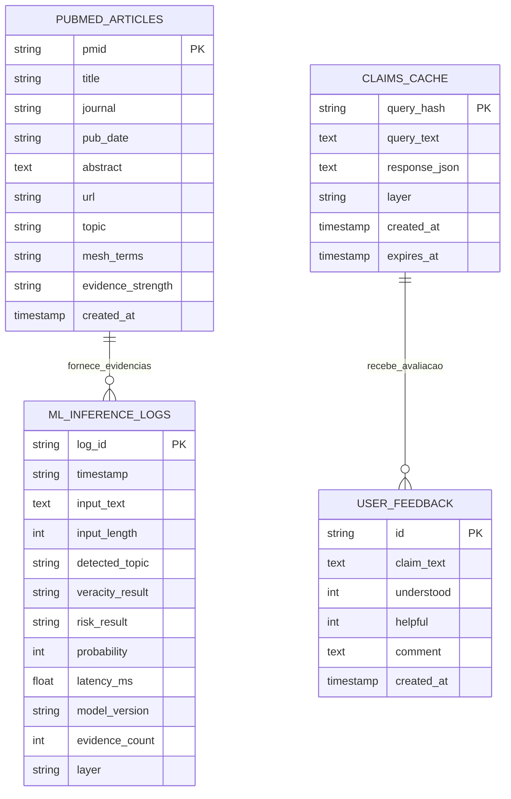
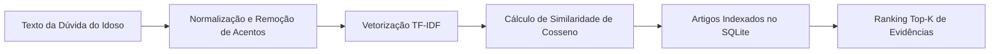

# Banco de Dados & Armazenamento de ML

O MedFact utiliza uma estratégia híbrida de armazenamento estruturado em **SQLite (em modo WAL — Write-Ahead Logging)** e um **Banco Vetorial de Artigos do PubMed** para permitir buscas semânticas ultrarrápidas e auditoria contínua de inferências de Machine Learning.

---

## 🗄️ Esquema Relacional do Banco de Dados (`medfact_ml.db`)

---

## 📊 Dicionário de Dados das Tabelas

### 1. Tabela `pubmed_articles`
Armazena a base de conhecimento científico com artigos revisados por pares das principais revistas biomédicas do mundo (*The Lancet*, *New England Journal of Medicine*, *JAMA*, *Journal of Alzheimer's Disease*).

| Coluna | Tipo | Descrição |
| :--- | :--- | :--- |
| `pmid` | `TEXT PRIMARY KEY` | Identificador único global do artigo no PubMed (PubMed ID). |
| `title` | `TEXT NOT NULL` | Título do artigo científico em inglês. |
| `journal` | `TEXT` | Nome do periódico científico internacional. |
| `pub_date` | `TEXT` | Ano de publicação ou data de indexação no NCBI. |
| `abstract` | `TEXT` | Resumo completo dos métodos, resultados e conclusões do estudo. |
| `url` | `TEXT` | Link direto para consulta do artigo na plataforma pública do PubMed. |
| `topic` | `TEXT NOT NULL` | Eixo temático: `vacinação`, `COVID-19` ou `doenças crônicas`. |
| `mesh_terms` | `TEXT` | Vocabulário controlado de termos médicos (*Medical Subject Headings*). |
| `evidence_strength` | `TEXT` | Classificação metodológica (ex: Ensaio Clínico Randomizado, Metanálise). |
| `created_at` | `TIMESTAMP` | Data e hora em que o registro foi inserido no banco local. |

---

### 2. Tabela `claims_cache`
Evita recomputação desnecessária e consumo de cotas de APIs externas ao guardar consultas já respondidas.

| Coluna | Tipo | Descrição |
| :--- | :--- | :--- |
| `query_hash` | `TEXT PRIMARY KEY` | Hash MD5 do texto da alegação após normalização ortográfica. |
| `query_text` | `TEXT NOT NULL` | Texto original enviado pelo usuário. |
| `response_json` | `TEXT NOT NULL` | Payload JSON completo da resposta retornada ao frontend. |
| `layer` | `TEXT NOT NULL` | Origem da checagem: `camada_1` ou `camada_2`. |
| `created_at` | `TIMESTAMP` | Momento em que a resposta foi armazenada em cache. |
| `expires_at` | `TIMESTAMP` | Data limite para invalidação e revalidação da checagem. |

---

### 3. Tabela `ml_inference_logs`
Tabela fundamental para observabilidade e **MLOps**, registrando o histórico de todas as predições para detecção de **Data Drift** e degradação de performance.

| Coluna | Tipo | Descrição |
| :--- | :--- | :--- |
| `log_id` | `TEXT PRIMARY KEY` | UUID único da transação de inferência. |
| `timestamp` | `TEXT NOT NULL` | Timestamp UTC em formato ISO-8601. |
| `input_text` | `TEXT NOT NULL` | Texto integral enviado para análise. |
| `input_length` | `INTEGER` | Quantidade de caracteres da mensagem recebida. |
| `detected_topic` | `TEXT NOT NULL` | Tema atribuído pelo classificador de Machine Learning. |
| `veracity_result` | `TEXT NOT NULL` | Rótulo atribuído: `falsa`, `verdadeira`, `enganosa`, `não verificável`. |
| `risk_result` | `TEXT NOT NULL` | Nível de risco previsto: `alto`, `médio` ou `baixo`. |
| `probability` | `INTEGER` | Probabilidade percentual de desinformação (0 a 100). |
| `latency_ms` | `REAL` | Tempo de processamento medido em milissegundos. |
| `model_version` | `TEXT NOT NULL` | Versão do modelo de Machine Learning que gerou a predição. |
| `evidence_count` | `INTEGER` | Quantidade de artigos científicos associados como evidência. |
| `layer` | `TEXT NOT NULL` | Camada que resolveu a requisição. |

---

### 4. Tabela `user_feedback`
Mede a eficácia comunicativa e o impacto social do MedFact entre idosos e seus familiares.

| Coluna | Tipo | Descrição |
| :--- | :--- | :--- |
| `id` | `TEXT PRIMARY KEY` | UUID da avaliação de feedback. |
| `claim_text` | `TEXT NOT NULL` | Alegação que estava sendo consultada. |
| `understood` | `INTEGER` | `1` se o idoso compreendeu a explicação; `0` se achou confusa. |
| `helpful` | `INTEGER` | `1` se considerou a resposta útil para sua decisão de saúde; `0` se não. |
| `comment` | `TEXT` | Observações livres ou sugestões dos usuários. |

---

## 🧠 Funcionamento do Banco Vetorial (`PubMedVectorStore`)

O componente `PubMedVectorStore` viabiliza a recuperação semântica de evidências científicas através das seguintes etapas:

1. **Normalização Prévia:** O texto de entrada tem seus acentos removidos via `unicodedata.normalize('NFD')`, é convertido para minúsculas e caracteres especiais são expurgados.
2. **Espaço Vetorial:** Um vocabulário com *n-grams* (1 a 2) e pesos sublineares mapeia o título, o resumo e os termos MeSH de cada artigo cadastrado.
3. **Ponderação Especial:** O título do estudo científico possui peso duplo em relação ao resumo, garantindo alta relevância temática imediata.
4. **Similaridade de Cosseno:** A proximidade angular entre a dúvida e os vetores de artigos determina o *Relevance Score* (entre 0.0 e 1.0).
5. **Filtragem de Corte:** Artigos com score abaixo de 0.08 são descartados para evitar falso embasamento em temas não correlatos.

---

## 🌐 Pipeline de Ingestão Contínua do PubMed

Além do banco de sementes inicial pré-carregado com estudos fundamentais, o sistema conta com ingestão dinâmica via API do NCBI:

1. Se uma consulta inédita não atingir o limiar mínimo de similaridade no banco local, a função `_buscar_ncbi_live` traduz os termos-chave do português para o inglês médico (ex: *"pressão alta"* ➡️ *"hypertension"*).
2. Consulta o `esearch.fcgi` e recupera os PMIDs mais recentes.
3. Consulta o `esummary.fcgi` para obter os títulos, autores, datas e periódicos.
4. **Auto-aprendizado da Base:** Os novos artigos são persistidos na tabela `pubmed_articles` e o índice vetorial é atualizado dinamicamente em memória.
