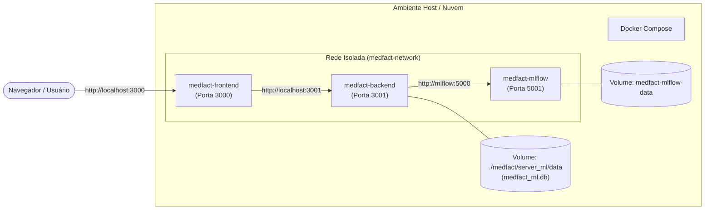
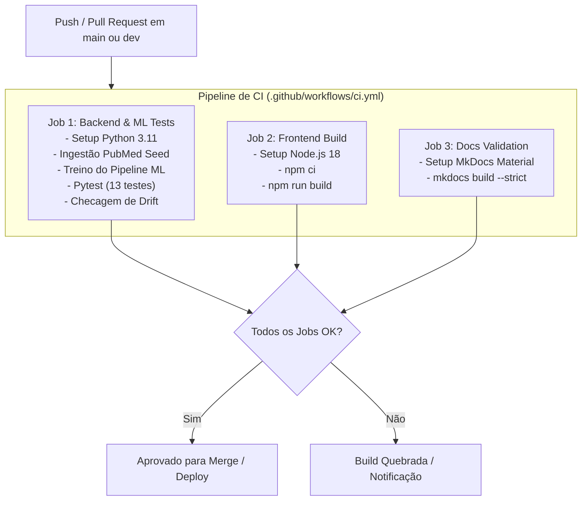

# DevOps & CI/CD em Produção

O MedFact adota práticas consagradas de **DevOps** para garantir estabilidade, segurança, facilidade de implantação e integração contínua automatizada.

---

## 🐳 Conteinerização com Docker & Docker Compose

Toda a infraestrutura do MedFact está conteinerizada, garantindo que o software execute de forma idêntica em qualquer sistema operacional (Linux, macOS ou Windows).

### Arquitetura de Contêineres



---

## ⚙️ Orquestração Multi-Serviço (`compose.yaml`)

O arquivo `compose.yaml` (também disponibilizado como `docker-compose.yml`) define a composição dos três microsserviços do sistema:

```yaml
services:
  backend:
    build:
      context: ./medfact/server_ml
      dockerfile: Dockerfile
    container_name: medfact-backend
    ports:
      - "3001:3001"
    environment:
      - PORT=3001
      - HOST=0.0.0.0
      - GROQ_API_KEY=${GROQ_API_KEY:-}
      - GOOGLE_FACTCHECK_KEY=${GOOGLE_FACTCHECK_KEY:-}
      - PUBMED_API_KEY=${PUBMED_API_KEY:-}
      - MLFLOW_TRACKING_URI=http://mlflow:5000
    volumes:
      - ./medfact/server_ml/data:/app/data
    depends_on:
      - mlflow
    restart: unless-stopped

  frontend:
    build:
      context: ./medfact/client
      dockerfile: Dockerfile
    container_name: medfact-frontend
    ports:
      - "3000:3000"
    environment:
      - REACT_APP_API_URL=http://localhost:3001
    depends_on:
      - backend
    restart: unless-stopped

  mlflow:
    build:
      context: .
      dockerfile: mlops/Dockerfile
    container_name: medfact-mlflow
    ports:
      - "5001:5000"
    volumes:
      - medfact-mlflow-data:/app/data
    restart: unless-stopped

volumes:
  medfact-mlflow-data:
    name: medfact-mlflow-data
```

### Comandos de Operação:

```bash
# Subir toda a infraestrutura em background
docker compose up -d --build

# Verificar logs em tempo real
docker compose logs -f backend

# Parar todos os serviços
docker compose down
```

---

## 🔄 Pipelines de CI/CD (GitHub Actions)

A esteira de integração e entrega contínua está implementada em dois workflows no diretório `.github/workflows/`:

### 1. Workflow de CI (`ci.yml`)
Disparado a cada `push` ou `pull_request` nas branches `main` e `dev`. Executa automaticamente três *jobs* paralelos:



### 2. Workflow de Deploy de Documentação (`deploy-docs.yml`)
Disparado a cada alteração na pasta `docs/` na branch `main`:
- Instala `mkdocs-material` e extensões.
- Executa `mkdocs gh-deploy --force`.
- Publica o site estático automaticamente no branch `gh-pages` do repositório, mantendo o portal de documentação sempre atualizado.

---

## 🩺 Endpoints de Saúde e Observabilidade

O backend implementa endpoints dedicados para integração com *healthchecks* de contêineres e balanceadores de carga:

- `GET /health` ou `GET /api/health`:
  Retorna status da API, integridade da conexão com o banco SQLite e contagem de artigos indexados.
  ```json
  {
    "status": "online",
    "servico": "MedFact Machine Learning & PubMed Service",
    "versao": "2.0.0",
    "banco_dados": true,
    "artigos_indexados": 12,
    "modelo_ml_carregado": true
  }
  ```

- `GET /api/metrics`:
  Exponibiliza métricas de monitoramento em tempo real (latência média, total de inferências acumuladas, distribuição de temas e proporção de risco).
