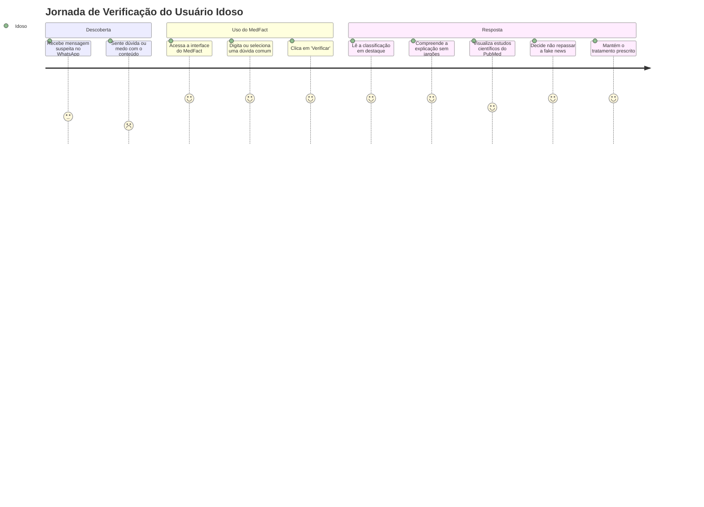

# Escopo e Requisitos do MedFact

Este documento consolida os objetivos de negócio, a delimitação do MVP, os objetivos de Machine Learning e o conjunto formal de requisitos funcionais e não-funcionais do MedFact.

---

## 🎯 Objetivo de Negócio

Reduzir o impacto sanitário e social da desinformação em saúde sobre a população idosa, fornecendo uma ferramenta acessível e segura que analisa afirmações textuais sobre **vacinação, COVID-19 ou doenças crônicas** e apresenta uma avaliação pedagógica baseada em evidências científicas — indicando veracidade, tipo de manipulação, nível de risco e explicação descomplicada.

### Jornada do Usuário Idoso

---

## 📐 Delimitação de Escopo (MVP)

Para garantir alta acurácia científica, rastreabilidade e viabilidade técnica, o escopo foi refinado conforme a tabela comparativa:

| Dimensão | Escopo Amplo Inicial | Escopo Consolidado MedFact (MVP) |
| :--- | :--- | :--- |
| **Modalidade de Entrada** | Texto, áudio, links, imagem, vídeo | **Exclusivamente texto** |
| **Abrangência Temática** | Qualquer assunto médico/nutricional | **3 temas focais**: Vacinação · COVID-19 · Doenças crônicas |
| **Público-Alvo** | População geral | **Pessoas idosas (60+ anos)** e seus cuidadores/familiares |
| **Estratégia de Análise** | Processamento monolítico indistinto | **Duas Camadas**: Camada 1 (Checagem Jornalística) + Camada 2 (ML + PubMed + LLM) |
| **Formato de Resposta** | Rótulo binário "Fake News / Verdade" | **Resposta pedagógica completa** com evidências, risco e explicação didática |

---

## 🤖 Objetivos de Machine Learning

O pipeline de Machine Learning visa solucionar simultaneamente três tarefas fundamentais:

| Tarefa de ML | Variável Prevista | Classes Possíveis | Métrica de Desempenho |
| :--- | :--- | :--- | :--- |
| **Classificação de Tema** | Tema biomédico | `vacinação`, `COVID-19`, `doenças crônicas` | **F1-Score (Macro)** $\ge 0.90$ |
| **Predição de Veracidade** | Rótulo de verdade científica | `verdadeira`, `falsa`, `enganosa`, `não verificável` | **F1-Score (Macro)** $\ge 0.85$ |
| **Avaliação de Risco Clínico** | Gravidade do dano potencial | `baixo`, `médio`, `alto` | **Kappa Quadrático Ponderado** |

> [!IMPORTANT]
> **Métrica de Segurança Crítica:** O sistema prioriza maximizar o **Recall da classe "falsa" e "enganosa"**. Deixar passar uma fake news letal como "verdadeira" (falso negativo) acarreta um custo clínico incomensuravelmente maior do que classificar preventivamente uma dúvida como "enganosa".

---

## 📋 Requisitos Funcionais (RF)

| ID | Descrição do Requisito | Camada / Módulo |
| :--- | :--- | :--- |
| **RF01** | O sistema deve aceitar a entrada de consultas textuais com no mínimo 5 caracteres, rejeitando textos vazios. | Frontend / Backend |
| **RF02** | O sistema deve consultar prioritariamente a Google Fact Check Tools API (Camada 1) usando a afirmação normalizada como query. | Backend (Camada 1) |
| **RF03** | Se a Camada 1 localizar uma checagem de agência reconhecida, o sistema deve retornar o resultado diretamente citando a agência de fact-checking. | Backend (Camada 1) |
| **RF04** | Caso a Camada 1 não localize correspondência, o fluxo deve acionar a Camada 2 de forma automática e transparente ao usuário. | Backend Orchestrator |
| **RF05** | A Camada 2 deve classificar o tema da consulta através do classificador supervisionado de Machine Learning. | ML Engine |
| **RF06** | O sistema deve consultar o banco vetorial de artigos científicos do **PubMed**, recuperando os estudos mais relevantes por similaridade semântica. | PubMed Vector Store |
| **RF07** | O sistema deve realizar a síntese pedagógica da resposta adaptada ao público idoso, detalhando o porquê científico da conclusão. | Synthesizer |
| **RF08** | Cada resultado deve citar explicitamente as referências biomédicas (título, revista e link no PubMed) ou a agência jornalística de checagem. | Frontend / Backend |

---

## ⚙️ Requisitos Não-Funcionais (RNF)

| ID | Descrição do Requisito | Critério de Aceite / Solução Adotada |
| :--- | :--- | :--- |
| **RNF01** | **Feedback de Espera:** Interface deve informar ao usuário o status do processamento com indicação clara. | Indicador textual "Verificando essa informação, um momento..." com contraste adequado. |
| **RNF02** | **Resiliência e Fallback:** O sistema nunca deve travar diante de indisponibilidade de APIs externas (Google, Groq ou NCBI). | Degradação graciosa: motor de ML e banco vetorial interno respondem sem dependência de internet externa. |
| **RNF03** | **Cache de Respostas:** Consultas idênticas ou semanticamente repetidas devem ser servidas instantaneamente. | Tabela `claims_cache` no SQLite com chave hash MD5 e expiração controlada. |
| **RNF04** | **Latência de Resposta:** Tempo total de inferência da Camada 2 deve ser inferior a 2500ms para consultas locais. | Busca vetorial baseada em representações esparsas/densas otimizadas com scipy/numpy. |
| **RNF05** | **Privacidade de Dados:** Nenhuma informação pessoal identificável (PII) do idoso deve ser armazenada nos logs de inferência. | O log armazena apenas o texto da alegação, tamanho em caracteres e métricas de inferência. |
| **RNF06** | **Acessibilidade para Terceira Idade:** A interface deve seguir diretrizes de alto contraste, fontes grandes e botões amplos. | Componentes dedicados (`AccessibilityBar`, tamanhos de fonte escaláveis, cores amigáveis). |
| **RNF07** | **Observabilidade MLOps:** Cada predição gerada deve ser registrada para auditoria e monitoramento de Data Drift. | Endpoint `/api/metrics` e tabela `ml_inference_logs` registrando latência e distribuição de classes. |