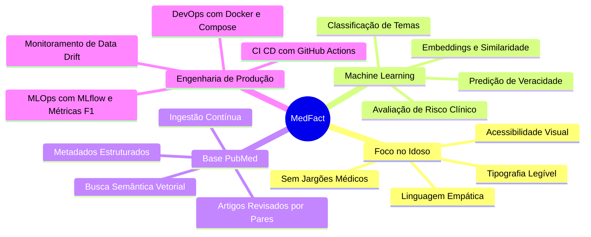

# MedFact — Detector de Desinformação em Saúde para Idosos

  <strong>Inteligência Artificial, Evidências Científicas do PubMed e Linguagem Acessível no Combate às Fake News para a Terceira Idade.</strong>

---

## 📌 Visão Geral do Projeto

O **MedFact** é uma plataforma inteligente concebida no contexto da disciplina de **Sistemas de Machine Learning** da Universidade de Brasília (UnB), desenvolvida pela equipe **Os Sem Classe**. 

O projeto tem como missão primordial **proteger a população idosa contra os impactos nocivos da desinformação em saúde**. Diariamente, milhões de idosos recebem em aplicativos de mensagens (como WhatsApp) conteúdos que prometem curas milagrosas para o câncer ou diabetes, ou alertas falsos sobre os perigos mortais de vacinas consolidadas.

Ao invés de emitir apenas um selo binário e frio de "Fake News" (o que pouco educa e pode causar atrito cognitivo), o MedFact:

1. **Analisa a alegação** em duas camadas inteligentes (Checagem rápida de agências jornalísticas e Análise aprofundada com Machine Learning).
2. **Consulta a base científica do PubMed** e recupera artigos científicos revisados por pares.
3. **Prediz veracidade, mecanismo da desinformação e nível de risco à vida**.
4. **Gera uma explicação em tom acolhedor, empático e com frases simples**, orientando o idoso a nunca abandonar seu tratamento e a dialogar com seu médico de confiança.

---

## 🎯 Pilares Estratégicos

---

## 🔍 Temas Centrais de Atuação

Devido à alta vulnerabilidade clínica e volume de desinformação direcionada à terceira idade, o MedFact foca em **três eixos prioritários**:

| Tema | Impacto na Terceira Idade | Exemplo de Desinformação Típica |
| :--- | :--- | :--- |
| **Vacinação** | Queda nas taxas de imunização contra gripe e pneumonia, elevando internações hospitalares e óbitos evitáveis. | *"A vacina contra a gripe altera o cérebro e causa Alzheimer em idosos."* |
| **COVID-19** | Uso de substâncias sem eficácia comprovada e retardo na busca por auxílio hospitalar em quadros respiratórios graves. | *"Doses cavalares de vitamina C curam a COVID-19 em 24 horas."* |
| **Doenças Crônicas** | Abandono de insulina, anti-hipertensivos e tratamentos oncológicos por crença em receitas caseiras milagrosas. | *"Beber água morna com limão em jejum cura qualquer câncer e elimina tumores."* |

---

## 🚀 Navegação Rápida pela Documentação

- [**Escopo e Requisitos**](escopo.md): Detalhamento do problema, delimitação de escopo, Requisitos Funcionais (RF) e Não-Funcionais (RNF).
- [**Arquitetura do Sistema**](arquitetura.md): Modelo C4, separação em Camada 1 e Camada 2, fluxo de dados de ponta a ponta.
- [**Tecnologias Utilizadas**](tecnologias.md): FastAPI, Scikit-learn, React, SQLite, PubMed E-utilities, Groq e Docker.
- [**Banco de Dados & PubMed**](banco-de-dados.md): Modelagem relacional, armazenamento de embeddings vetoriais e pipeline de ingestão.
- [**Machine Learning & RAG**](machine-learning.md): Modelos de inferência, RAG biomédico, matrizes de confusão e cálculo de F1-macro.
- [**Práticas de MLOps**](mlops.md): Rastreamento de experimentos com MLflow, detecção de Data Drift e retraining pipeline.
- [**Práticas de DevOps**](devops.md): Conteinerização Docker, Compose multi-serviço e workflows de CI/CD.
- [**Acessibilidade e Foco em Idosos**](acessibilidade.md): Heurísticas de design, mascote, sintetizador textual e contraste visual.
- [**Processos do Software**](processos-software.md): Ciclo de vida, garantia de qualidade e governança do projeto.
- [**Guia de Instalação e Execução**](instalacao.md): Como executar todo o ambiente localmente ou via contêineres Docker.
