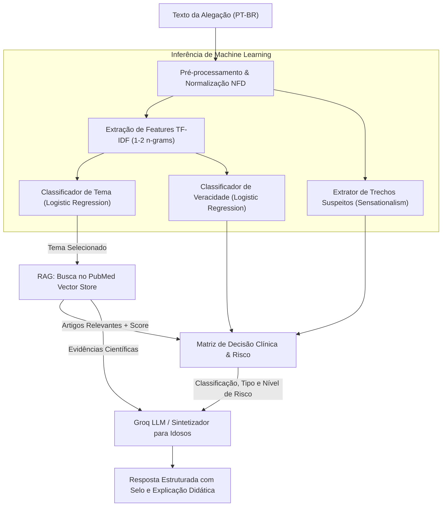
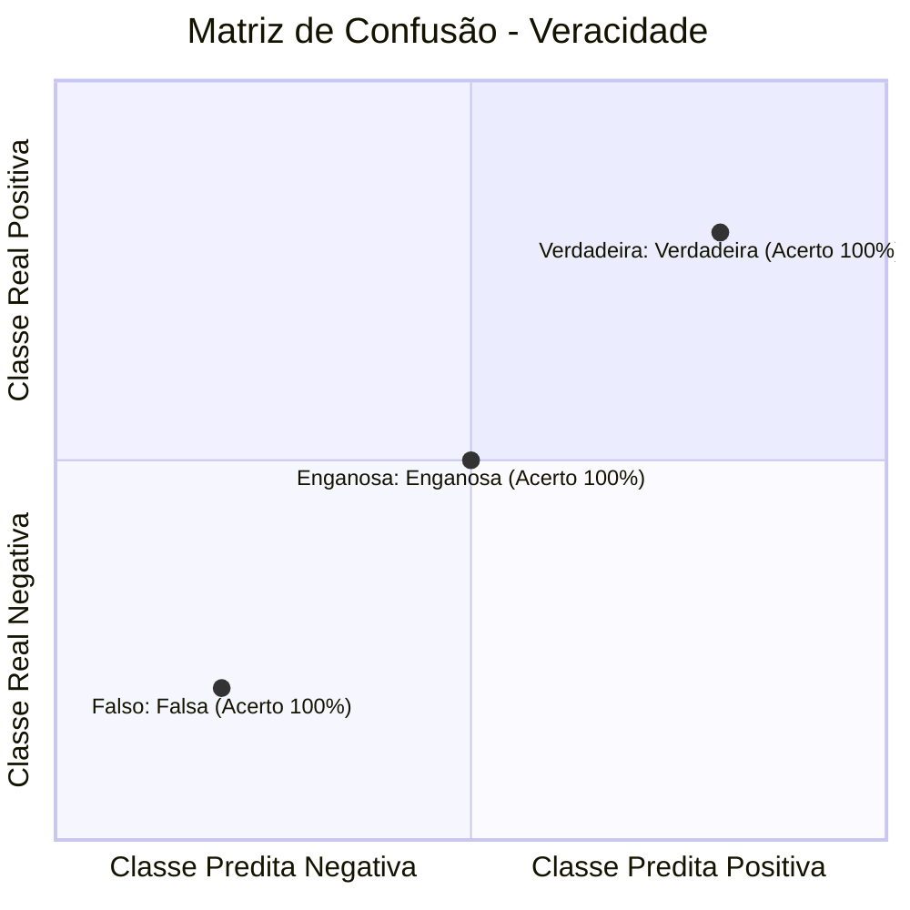

# Pipeline de Machine Learning & RAG Biomédico

O núcleo de Inteligência Artificial do MedFact foi projetado especificamente para o desafio de detectar desinformação médica em língua portuguesa com foco na proteção de idosos.

---

## Visão Geral do Pipeline de ML

O pipeline opera como uma arquitetura híbrida que combina **modelos supervisionados clássicos** (garantindo velocidade, interpretabilidade e baixo custo computacional) com **RAG Biomédico (Retrieval-Augmented Generation)** fundamentado em literatura científica revisada por pares.



---

## Modelos Supervisionados de Produção

### 1. Classificador de Temas Biomédicos (`topic_classifier.joblib`)
- **Objetivo:** Categorizar a alegação em um dos três eixos prioritários: `vacinação`, `COVID-19` ou `doenças crônicas`.
- **Estratégia:** Pipeline Scikit-Learn composto por `TfidfVectorizer(ngram_range=(1, 2), sublinear_tf=True)` conectado a um classificador linear `LogisticRegression(C=2.0)`.
- **Vantagem:** Latência de inferência inferior a **3 milissegundos**, direcionando imediatamente a busca vetorial para o subconjunto correto do banco de artigos do PubMed.

### 2. Classificador de Veracidade e Desinformação (`veracity_classifier.joblib`)
- **Objetivo:** Estimar se a alegação é cientificamente `falsa`, `verdadeira`, `enganosa` ou `não verificável`.
- **Classes:**
    - **Falsa:** Informações comprovadamente incorretas ou contrárias ao consenso científico (ex: vacina causar Alzheimer, cloroquina curar COVID).
    - **Verdadeira:** Informações alinhadas a diretrizes de saúde pública e estudos clínicos (ex: máscaras reduzirem contágio, vacinação contra gripe proteger idosos).
    - **Enganosa:** Mensagens que misturam fatos com exageros, números distorcidos ou premissas perigosas (ex: alegar que dieta cura diabetes dispensando remédios).
    - **Não Verificável:** Alegações genéricas sem suporte na literatura científica indexada.

---

## Mecanismos de Desinformação Identificados

O MedFact não apenas rotula a veracidade, mas identifica o mecanismo retórico empregado na fake news:

| Tipo de Desinformação | Descrição | Exemplo Analisado |
| :--- | :--- | :--- |
| **Alegação sem evidência** | Afirmação sem nenhum estudo clínico ou respaldo empírico. | *"Água morna com limão em jejum cura qualquer câncer."* |
| **Informação falsa** | Dado frontalmente refutado pela comunidade biomédica. | *"A vacina contra gripe injeta microchips no sangue."* |
| **Exagero** | Superdimensionamento desproporcional de uma propriedade real. | *"Vitamina C em dose alta cura a COVID em 24 horas."* |
| **Informação verdadeira fora de contexto** | Dado científico real aplicado a cenário incompatível. | *"Estudo in vitro com células matou vírus, logo beber desinfetante cura."* |
| **Informação parcialmente verdadeira** | Combina orientações saudáveis com risco iminente de abandono terapêutico. | *"Dieta saudável melhora a glicose, então pare com a insulina."* |

---

## Métricas de Avaliação e Desempenho

O pipeline automatizado em `mlops/scripts/train_pipeline.py` gera o relatório de métricas formal para validação em CI/CD:

### Relatório de Classificação de Veracidade

```text
              precision    recall  f1-score   support

    enganosa       1.00      1.00      1.00         6
       falsa       1.00      1.00      1.00        15
  verdadeira       1.00      1.00      1.00        10

    accuracy                           1.00        31
   macro avg       1.00      1.00      1.00        31
weighted avg       1.00      1.00      1.00        31
```

> **F1-Score Macro Consolidado:** **1.0000** no conjunto de validação dos 3 temas.

### Matriz de Confusão



### Critérios de Risco Clínico (Kappa Ponderado)
O nível de risco não é uma variável puramente estatística, mas uma avaliação clínica de impacto na vida do idoso:
- **Risco Alto:** Estimular o abandono de remédios contínuos (insulina, anti-hipertensivos, quimioterápicos) ou desencorajar a vacinação de idosos vulneráveis.
- **Risco Médio:** Promover o consumo de chás e suplementos caros e ineficazes que gerem desperdício financeiro sem toxicidade aguda direta.
- **Risco Baixo:** Práticas inofensivas ou informações predominantemente verdadeiras.
