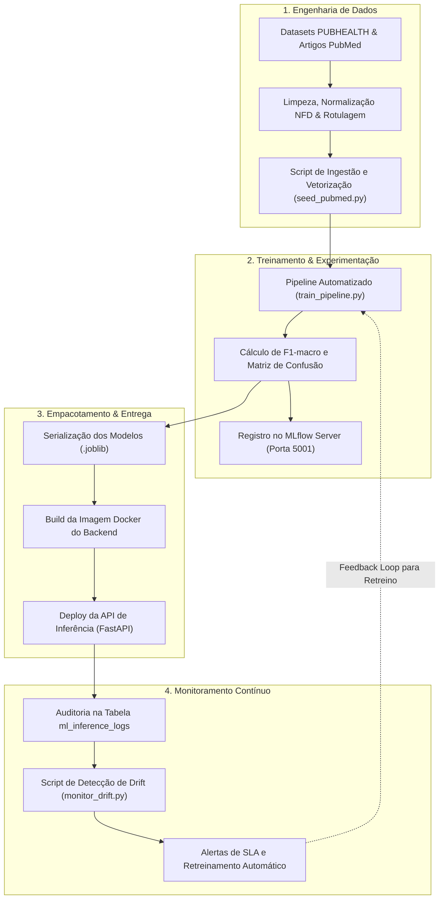

# MLOps em Produção

O MedFact incorpora as melhores práticas de **Machine Learning Operations (MLOps)** para assegurar reprodutibilidade, governança, rastreabilidade de experimentos e monitoramento contínuo em ambiente de produção.

---

## 🔄 Ciclo de Vida do Modelo de ML



---

## 📊 Rastreamento de Experimentos com MLflow

O MedFact utiliza o **MLflow Tracking Server** conteinerizado (`medfact-mlflow` rodando na porta `5001` via Docker Compose):

### Parâmetros Registrados:
- `vectorizer`: Tipo de representação (`TfidfVectorizer(ngram=(1,2), sublinear_tf=True)`).
- `classifier`: Algoritmo supervisionado (`LogisticRegression`).
- `regularization_C`: Hiperparâmetro de regularização.
- `dataset_size`: Número de alegações no conjunto de treino.

### Métricas Monitoradas:
- `f1_macro_topic`: F1-Score macro do classificador de temas.
- `f1_macro_veracity`: F1-Score macro do classificador de veracidade.
- `accuracy`: Acurácia global das predições.
- `inference_latency_ms`: Tempo de resposta no endpoint.

### Artefatos Versionados:
- `evaluation_metrics.json`: Relatório consolidado de métricas por classe.
- `topic_classifier.joblib`: Binário treinado para classificação temática.
- `veracity_classifier.joblib`: Binário treinado para predição de fake news.

---

## 🕵️ Detecção de Data Drift e Telemetria

Em aplicações de combate à desinformação, o vocabulário e os tipos de boatos sofrem mutações constantes (**Concept Drift** e **Covariate Shift**). O script `mlops/scripts/monitor_drift.py` analisa periodicamente as últimas 100 inferências registradas na tabela `ml_inference_logs`:

### Variáveis Monitoradas:
1. **Comprimento Médio da Consulta (`input_length`):** Detecta se os usuários estão enviando mensagens mais longas (ex: correntes de WhatsApp coladas na íntegra).
2. **Distribuição Percentual de Temas:** Sinaliza surtos sazonais (ex: aumento repentino de dúvidas sobre dengue ou nova vacina).
3. **Distribuição de Veracidade:** Se a proporção de alegações falsas ultrapassar **85%**, um alerta de *"Possível surto de desinformação viral"* é emitido.
4. **Violação de SLA:** Se a latência média ultrapassar **2500ms**, um alerta de degradação é acionado.

```bash
# Executando a auditoria de drift manualmente
py mlops/scripts/monitor_drift.py
```

Exemplo de saída do monitor de drift:

```json
{
  "timestamp_analise": "2026-10-18T15:04:14.218520",
  "total_amostras_analisadas": 35,
  "tamanho_medio_entrada_chars": 48.2,
  "latencia_media_ms": 14.8,
  "distribuicao_temas_pct": {
    "vacinação": 42.9,
    "COVID-19": 28.6,
    "doenças crônicas": 28.5
  },
  "distribuicao_veracidade_pct": {
    "falsa": 60.0,
    "enganosa": 25.7,
    "verdadeira": 14.3
  },
  "alertas_drift": []
}
```

---

## 🔁 Pipeline de Retreinamento Contínuo

Quando novas checagens ou artigos científicos são inseridos na base ou quando o monitor de drift identifica necessidade de calibração, o retreinamento pode ser disparado em um único comando:

```bash
# Executa retreino, avaliação e atualização dos artefatos de produção
py mlops/scripts/train_pipeline.py
```

O script reavalia os modelos, sobrescreve os arquivos `.joblib` em `medfact/server_ml/app/ml_models/` e atualiza os relatórios de métricas versionados.
