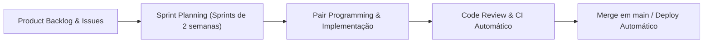

# Processos de Engenharia de Software & Governança

Este documento descreve os processos de engenharia, governança de dados, qualidade de código e metodologia de ciclo de vida adotados no desenvolvimento e manutenção do **MedFact**.

---

## 🔄 Metodologia de Desenvolvimento

A equipe adotou uma abordagem ágil híbrida baseada em **Scrum/Kanban** com ciclos curtos de entrega contínua:



### Estratégia de Branches (Git Flow Simplificado):
- `main`: Branch estável de produção. Apenas código testado e aprovado em CI é integrado aqui.
- `dev`: Branch de integração onde novas features convergem antes da homologação final.
- `feat/*` e `fix/*`: Branches de trabalho efêmeras criadas para funcionalidades ou correções específicas (ex: `feat/mlops-setup`, `fix/backend`).

---

## 🧪 Estratégia e Pirâmide de Testes

A integridade do software é assegurada por múltiplas camadas de testes automatizados:

```mermaid
pyramid
    title Pirâmide de Testes MedFact
    "Testes Ponta a Ponta (Frontend/Backend)" : 20
    "Testes de Integração de API & Banco SQLite" : 40
    "Testes Unitários de ML & Vetorização" : 80
```

### 1. Testes Unitários de Machine Learning (`test_ml.py`)
- Valida a correta categorização temática das alegações (`vacinação`, `COVID-19`, `doenças crônicas`).
- Verifica a predição de veracidade contra padrões de desinformação conhecidos (curas milagrosas, promessas irreais).
- Testa a extração de trechos suspeitos por expressões regulares.

### 2. Testes de Integração de Banco & PubMed (`test_pubmed.py`)
- Garante a inicialização correta das tabelas no SQLite em modo WAL.
- Valida a recuperação semântica no `PubMedVectorStore` assegurando que estudos reais sobre Alzheimer e gripe retornem com score relevante.

### 3. Testes de Endpoints da API (`test_api.py`)
- Testa as respostas nos endpoints `/health`, `/api/metrics`, `/api/verify`, `/api/database/articles` e `/api/feedback`.
- Assegura que textos curtos (< 5 caracteres) sejam rejeitados com código HTTP 400/422.
- Verifica a presença de todos os campos obrigatórios esperados pelo frontend (`origem`, `classificacao`, `explicacao`, `evidencias`).

---

## 🛡️ Governança Ética e Privacidade de Dados

A manipulação de consultas médicas exige rígidos padrões éticos e de proteção à privacidade (LGPD):

1. **Anonimização Radical de Entrada:**
   - O MedFact **não solicita nem armazena** nome, CPF, e-mail, telefone, IP ou localização do idoso.
   - Os logs na tabela `ml_inference_logs` contêm apenas o texto da dúvida e métricas de desempenho computacional.

2. **Mitigação de Alucinação e Risco Clínico:**
   - Todas as classificações são respaldadas por evidências científicas verificáveis do PubMed ou checagens jornalísticas da Camada 1.
   - O sistema nunca prescreve dosagens de medicamentos, nunca diagnostica doenças individuais e inclui sistematicamente o alerta de aconselhamento médico presencial.

3. **Transparência e Ciência Aberta:**
   - Todo o código-fonte, dados de teste e modelos treinados estão versionados publicamente no repositório do projeto, permitindo escrutínio acadêmico e reprodutibilidade por pesquisadores.
